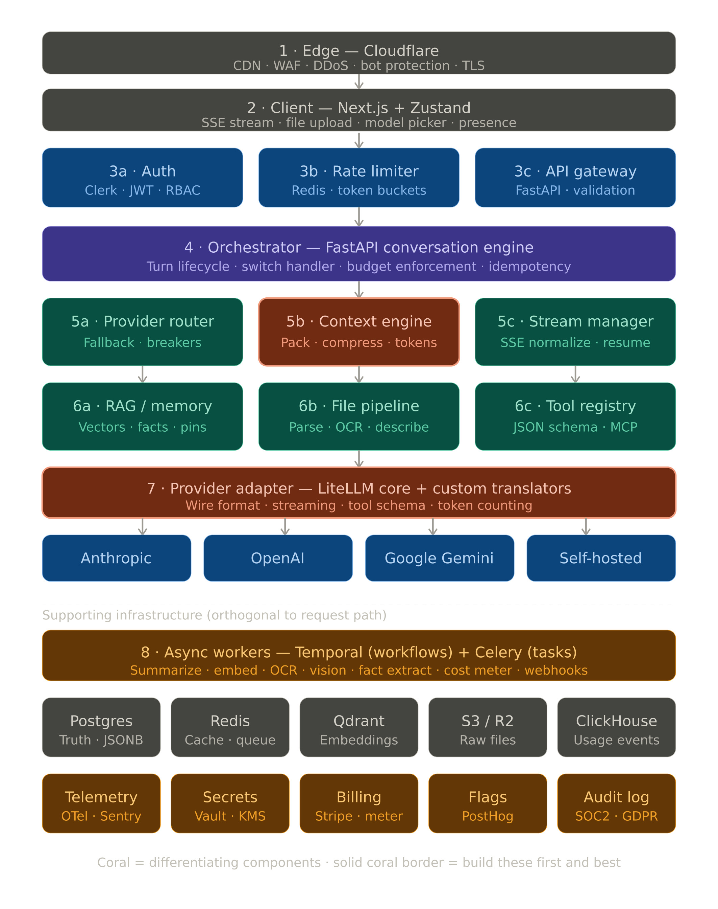

# SYNQ

**Cross-model conversation continuity.** Start a chat with one LLM, hit a rate limit or want a different model, and continue the same conversation on another provider without losing context.

**Live demo:** https://synq-web-snowy.vercel.app



Soft-launched to 17 beta testers; their feedback drove a full UI redesign.
<!-- CONFIRM: "17 beta testers" and the redesign are taken from your resume -->

---

## The problem

Switching LLM providers mid-conversation normally means starting over. Each provider has a different context window, message format, tokenizer and file support, so long chats, uploaded files and earlier decisions get lost.

## How SYNQ solves it

1. **Canonical storage.** Every message is stored once as provider-neutral JSONB content blocks in PostgreSQL (never as a plain string). Provider adapters translate to and from each vendor's format.
2. **Context engine.** For each request, the engine builds a prompt that fits the target model's context window from extracted facts, a rolling summary, Qdrant-retrieved chunks and the most recent turns. <!-- CONFIRM: facts, rolling summary and Qdrant retrieval are all merged and working in the code; README previously listed them as Phase 4 -->
3. **Multimodal continuity.** Files are parsed asynchronously (PDF, DOCX, TXT/MD, and images via OCR plus vision descriptions). A vision-capable model receives the original bytes; a text-only model receives the stored description, so it still knows what was in the file.
4. **Resilience.** Requests go through a provider router with Redis-backed circuit breakers and fallback to another provider when one fails or is rate limited. <!-- CONFIRM: Phase 5 router and circuit breaker are in the code -->

## Features

- Streaming chat over SSE, with history restored from PostgreSQL on refresh
- Multi-provider support (Gemini, Groq, Mistral) behind a `ProviderAdapter` interface and LiteLLM, with a per-message model picker <!-- CONFIRM: provider list; the earlier README mentioned Claude, GPT and Gemini -->
- Per-provider token counting with caching
- Idempotent message writes (replaying the same `idempotency_key` returns the original turn)
- Versioned conversations (`conversations.version` increments after each assistant reply)
- File uploads to S3-compatible storage (MinIO locally), with a Celery parse pipeline and per-provider `resolve_file` using vision capability flags
- Gemini Files API integration with Redis URI caching
- Chat UI with drag-and-drop, paste and chip-row attachments
- Clerk authentication with FastAPI JWT verification

## Reliability and testing

- **Chaos test:** synthetic `429` errors are injected to verify provider failover. See [CHAOS_TEST.md](CHAOS_TEST.md). <!-- CONFIRM: file describes the 429 test and its result -->
- CI runs lint and type checks (`ruff`, `mypy`, `eslint`, `tsc`).

## Tech stack

| Layer | Choice |
|---|---|
| Frontend | Next.js 14 (App Router), TypeScript, Tailwind, Zustand, shadcn/ui |
| Backend | FastAPI (Python 3.12), managed with `uv` |
| Auth | Clerk |
| Database | PostgreSQL 16, Alembic migrations |
| Cache and queue | Redis 7 (two instances: cache and queue) |
| Vector store | Qdrant |
| Workers | Celery |
| File storage | S3-compatible (MinIO locally) |
| LLM layer | LiteLLM plus custom provider adapters |
| Infra | Docker Compose, Render (API), Vercel (web) <!-- CONFIRM: hosting --> |

## Repository layout

```
synq/
├── apps/
│   ├── web/              # Next.js 14, TypeScript, Tailwind, Zustand, shadcn/ui
│   └── api/              # FastAPI, Python 3.12, uv
├── packages/
│   └── shared-types/     # TypeScript types mirroring Pydantic models
├── scripts/
├── docker-compose.yml    # Postgres 16, Redis 7 (x2), MinIO
├── .github/workflows/    # CI: lint and typecheck
├── ARCHITECTURE.pdf
├── CHAOS_TEST.md
└── DEPLOY.md
```

## Local setup

**Prerequisites:** Node.js 22+, Python 3.12+, [uv](https://docs.astral.sh/uv/), Docker Desktop.

```bash
git clone https://github.com/ShreyanshuGhosh/SYNQ.git synq && cd synq
cp .env.example .env
cp apps/api/.env.example apps/api/.env
cp apps/web/.env.example apps/web/.env.local

docker compose up -d              # Postgres, Redis x2, MinIO

npm install                       # web app and shared packages

cd apps/api
uv sync
uv run alembic upgrade head       # apply migrations
cd ../..
```

**Configure keys:**

- **Clerk:** create an app at https://dashboard.clerk.com. Put the publishable and secret keys in `apps/web/.env.local`, and `CLERK_JWKS_URL` and `CLERK_ISSUER` in `apps/api/.env`.
- **Gemini:** a free-tier key from https://aistudio.google.com/apikey goes in `GEMINI_API_KEY`. `DEFAULT_MODEL` defaults to `gemini-2.5-flash`.
- Add keys for any other providers you enable (Groq, Mistral) in `apps/api/.env`. <!-- CONFIRM: env variable names -->

**Run:**

```bash
# API (from apps/api)
uv run uvicorn app.main:app --reload --port 8000      # http://localhost:8000/docs

# Celery worker (from apps/api, separate terminal)
uv run celery -A app.workers.celery_app worker --loglevel=info

# Web (from repo root)
npm run dev:web                                        # http://localhost:3000
```

Image OCR needs [Tesseract](https://github.com/UB-Mannheim/tesseract/wiki) (`brew install tesseract` or `sudo apt install tesseract-ocr`). It is best effort: without it, the vision-model description still populates `files.description`.

## Quick verification

1. Sign up at http://localhost:3000 and start a new chat; tokens stream into the reply.
2. Refresh the page; history reloads from Postgres.
3. Check canonical storage:

```bash
docker compose exec postgres psql -U synq -d synq_dev -c \
  "SELECT id, role, content, model_used, token_counts FROM messages ORDER BY created_at DESC LIMIT 4;"
```

`content` is a JSONB array of blocks, and `model_used` is the exact pinned model id.

4. Idempotency check (the second call replays the first, no new turn):

```bash
curl -N -X POST http://localhost:8000/conversations/<conv-id>/messages \
  -H "Authorization: Bearer <JWT>" -H "Content-Type: application/json" \
  -d '{"content":[{"type":"text","text":"hi"}],"idempotency_key":"abc-123"}'
```

## Useful commands

| Command | What it does |
|---|---|
| `npm run lint` / `npm run typecheck` | ESLint and tsc on the web app and shared types |
| `cd apps/api && uv run ruff check .` | Lint Python |
| `cd apps/api && uv run mypy app/` | Type-check Python |
| `cd apps/api && uv run pytest` | Run API tests |
| `docker compose down -v` | Stop infra and wipe volumes |

## Status

- [x] **Phase 1 - Foundation:** Clerk auth, Postgres schema with indexes and `version` column, conversation REST API, SSE streaming
- [x] **Phase 2 - Multi-provider:** `ProviderAdapter`, token counting, model picker, truncation
- [x] **Phase 3 - Multimodal:** S3 uploads, Celery parse and OCR pipeline, vision descriptions, Gemini Files API with Redis caching
- [x] **Phase 4 - Intelligence:** Qdrant embedder, rolling summaries, fact extraction, RAG retriever <!-- CONFIRM: all four are working -->
- [x] **Phase 5 - Resilience:** provider router with fallback chains, Redis-backed circuit breakers, chaos test <!-- CONFIRM -->
- [ ] **Planned:** cost metering (ClickHouse) with per-user spend limits, OpenTelemetry tracing, Sentry, usage-based billing, long-conversation (300+ turn) test fixtures, conversation forking, MCP tool integration

## Docs

- [Architecture](ARCHITECTURE.pdf)
- [Chaos test](CHAOS_TEST.md)
- [Deployment](DEPLOY.md)
